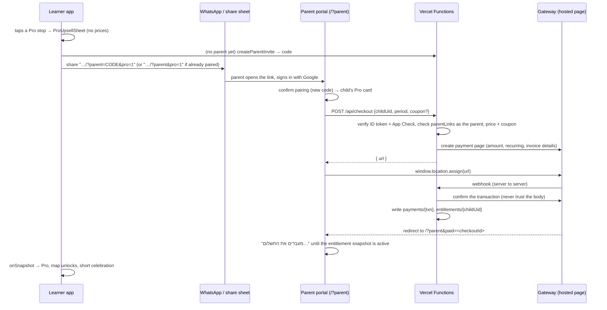

# Pro Tier & Payments (EnglishVibe Pro)

> Backlog: "Define the Freemium vs. 'EnglishVibe Pro' tier boundaries … design the kid-safe 'Ask a Parent on WhatsApp' payment link flow … plan integration with an Israeli payment gateway … and server-verified Firestore subscription status. Also create a coupon system."

Status: **server payments layer, Phase 1 and Phase 2 built**: checkout, webhook, plan changes, Grow adapter and rules ("Server (built)"), the learner-side gating with its "ask a parent" sheet, switched off (`PRO_GATING_ENABLED = false`), and the parent portal's checkout and Pro lines on the mock provider (dev server only). The phases in "Implementation phases" are the build order.

## Goal
Most of the app stays free. A paid **EnglishVibe Pro** subscription (monthly or yearly) unlocks the full curriculum and the Pro content packs, full exam prep, more word lists and every theme and mascot. The learner never pays and never sees a checkout. They ask a parent, and the paired parent pays from the parent portal. Only the server decides who has Pro.

## Principles
- **Kid-safe.** The learner app shows no prices, no card form and no payment page. It shows what Pro unlocks and one button that asks a parent.
- **The payer is the paired parent.** Payment builds on parent pairing (§4.21): the parent's own Google account, `parentLinks/{parent}_{child}`. Links carry a parent code, never a learner uid.
- **The server owns entitlements.** `entitlements/{childUid}` is written only by Vercel Functions with the service account. Clients can read it but never write it.
- **Nothing is taken away mid-progress.** A mission that already has stars stays playable without Pro, and so do exam plans and word lists that already exist. Gating only stops *new* paid content.
- **Gating sits outside the current lock logic.** The progress locks (`isMissionUnlocked`, the Boss star gate, `isMockUnlocked`) keep working as they do. A separate Pro layer is added on top of them.
- **Hebrew copy** that speaks to the learner is gendered (`getHebrewCopy`). Copy that speaks to the parent is gender-neutral plural ("אפשר לשדרג…").

## Decisions
| Question | Decision |
| :--- | :--- |
| Product | One plan, **EnglishVibe Pro**, billed monthly or yearly. The price depends on how many children it covers (1–4; larger families contact us on WhatsApp); see "Pricing and seats". |
| Exam Booster Pass (one-time) | Not now. Exam prep is a Pro feature. It is an open question for later. |
| Gateway | **Grow (Meshulam)** behind a `PaymentProvider` interface, with a `mock` provider for the emulators and e2e. Monthly plans are Grow recurring charges; yearly plans are one-time payments that don't renew by themselves. |
| Where Pro lives | `entitlements/{childUid}`, **not** on `LearnerProfile`. Sync and `mergeLearnerProfiles` are not affected. |
| One subscription covers | 1 to 4 children of the paying parent (seats). |
| Who manages it | **Only the paying parent.** Another parent paired with the same child sees the Pro status but cannot cancel or change the plan (`api/subscription.ts` answers 404 for another parent's plan). |
| Yearly renewal | Yearly plans don't renew by themselves, so Grow sends no reminder. **Our own in-app notice:** from 14 days before `periodEnd`, the parent portal's Pro card shows the end date and a renew button. No email or push to build. |
| Referrals | Parent invites parent. The new family gets 50% off its first month. The inviting parent gets a free month once the new family's first full-price charge goes through. No cap. Children never get paid rewards. |
| Existing users | None yet besides the developer's own children, who get a `comp` grant (`scripts/grantPro.mjs`). Starred missions stay playable for everyone. |
| Rollout switch | `PRO_GATING_ENABLED` (in `config/proTier.ts`) stays `false` until payments work end to end. Until then everyone plays everything. |
| Diamonds-bought items | Separate from Pro. The Sticker Studio Pass (`hasStickerPass`, `data/stickers.ts`) stays a 150-diamond shop item. Diamonds never buy Pro, and Pro never grants diamonds. |

## Tier boundaries
| Area | Free | Pro |
| :--- | :--- | :--- |
| Missions (core curriculum) | **Units 1–2** of every grade (all their missions and Bosses). Grade 1, which has 10 units, gets units 1–5 | Every unit and Boss of every grade |
| Content packs (§4.26), once released | Packs released as **free**: all their units | Every pack, including those released as **Pro only** |
| Themes & mascots (§4.3, §4.17) | **2 themes** (one light, one dark) and **2 mascots**; every other theme and mascot is shown and can be previewed | All 6 themes and all 6 mascots |
| Placement test (§4.8) | ✓ | ✓ |
| Exam prep (§4.9) | Setup, plus the plan's **first day** of practice as a taste | Full plans, every session, the mock exam and the "Exam Ready" certificate |
| School Word Lists (§4.11) | **2** active lists | 10 (`MAX_ACTIVE_LISTS`) |
| Friends Hub & contests (§4.14) | ✓ | ✓ |
| Room, wardrobe, games book, stickers, shop, diamonds | ✓ (shop items still cost diamonds) | ✓ |
| Streak, quests, weekly report, parent portal, reminders | ✓ | ✓ |
| Read-aloud voice, mini-lessons | ✓ for every mission the learner can play | ✓ |

Reasons:
- **Half of every grade is free** (units 1–2 of the four core units). A learner gets a real taste of their own grade, and the placement test's recommended grade is still worth trying. Units 3–4 are the Pro half. Grade 1 has 10 units: the letters (1–4), blending (5–6) and the topics (7–10). Its free half, units 1–5, keeps the whole alphabet and the first blending unit free. Each grade's free units are one config map, so this can be changed per grade.
- **Packs are free or Pro when they are released.** That is a release decision, not a property of the content, so it lives on the `RELEASED_CONTENT_PACKS` entry (see "Content packs" below).
- **Themes are a visible, low-stakes reason to upgrade.** A free learner sees all six and can try any of them, but only keeps the two free ones. The free pair is one playful light theme (Cozy Studio) and one grown-up dark theme (Urban Night), so both young children and older students have a free theme that suits them.
- **Friends and contests stay free** because they are what keeps learners coming back, and contests draw on the learner's own grade, with no paid content needed.
- **Contest questions** come from every unit. That is fine: contests are short, have no hints and are not a way around the mission path.

All limits are named constants in one file, `config/proTier.ts`:
- `FREE_CORE_UNITS_BY_GRADE`: `{ 1: [1, 2, 3, 4, 5] }`, every other grade `[1, 2]` (`DEFAULT_FREE_CORE_UNITS`)
- `FREE_THEME_IDS = ['cozy-studio', 'urban-night']`: one playful light theme and one grown-up dark one
- `FREE_COMPANION_IDS = ['mochi', 'kai']`: those two themes' own mascots (Mochi the Cat, Kai the Raccoon)
- `FREE_WORD_LISTS = 2`
- `FREE_EXAM_PREP_DAYS = 1`
- `PRO_GRACE_DAYS = 3`
- `PRO_GATING_ENABLED`

## Pricing and seats
All prices include VAT and live in `config/proTier.ts` as `PRO_PRICES_AGOROT`, keyed by the number of children (1–4) and period. The server reads them; the parent's plan picker only shows them (`quoteProPrice`).
- **Monthly:** ₪39 for the first child and ₪25 for each more.
- **Yearly:** about 9 monthly charges ("3 months free"), rounded down to end in 9.

| Children | Monthly | Yearly | Yearly per month | Saved per year |
| :--- | :--- | :--- | :--- | :--- |
| 1 | ₪39 | ₪349 | ≈ ₪29.08 | ₪119 |
| 2 | ₪64 | ₪569 | ≈ ₪47.42 | ₪199 |
| 3 | ₪89 | ₪799 | ≈ ₪66.58 | ₪269 |
| 4 | ₪114 | ₪999 | ≈ ₪83.25 | ₪369 |

Families with more than 4 children contact us on WhatsApp (the plan picker's button) for an extended plan.

**Plan picker** (`components/parent/ProPlanPicker.tsx`, in the parent portal; shown on the dev server only until checkout is wired, `IS_PRO_PLAN_VISIBLE`):
- **Billing switch:** חודשי / שנתי (3 חודשים מתנה), yearly by default.
- **Counter:** a 1–4 children stepper, starting at the parent's linked children.
- **Price box:** the charge, the per-month rate (yearly), the per-child monthly rate (2+ children), and the yearly saving. On monthly it says what yearly would save.
- **WhatsApp button:** "צריכים מנוי ליותר מ-4 ילדים? דברו איתנו בוואטסאפ" opens a WhatsApp chat with a prefilled message. Pressing + at 4 children highlights it and moves focus to it. The number is `SUPPORT_WHATSAPP_NUMBER` (`config/appInfo.ts`) (for now the owner's private number; replace it with a business number before launch).
- **Footer:** "התחברות אחת להורה עם פרופיל נפרד לכל ילד • אפשר לבטל בכל עת".
- **Continue button:** "המשך לתשלום" appears once checkout is wired (`onContinue`).

- **One subscription per paying parent.** `subscriptions/{id}` (server-only) holds:
  - `payerParentUid`, `period`, `seatLimit` (1–4) and `childUids` (at most `seatLimit`).
  - `status`, `periodEnd`, `provider`, `providerRef`, `lastSwapAt`, `freeMonthsBanked`.
  - Every child in `childUids` gets an `entitlements/{childUid}` mirror (`source: 'subscription'`, `subscriptionId`), so the learner app keeps reading one document.
- **Seats need a pairing.** A child can take a seat only if `parentLinks/{payer}_{child}` exists, checked on the server as the parent.
  - A child can be in only one active subscription at a time. `entitlements/{childUid}` already says which one, and `api/checkout.ts` refuses a second one.
  - A parent account can be linked to at most `MAX_LINKED_CHILDREN = 6` children (`api/checkout.ts` checks this; the pairing itself stays as it is).
- **Adding a child** to a monthly plan (e.g. 2 → 3) costs nothing extra now: the new child is Pro at once, and the higher price applies **from the next charge**.
  - The same goes for removing one. A yearly plan only fills the seats already paid for.
  - This needs the gateway to support changing a recurring amount; check it in P3. If it can't, cancel and re-create the recurring payment with the same next date.
- **Swapping a child** means removing one from a seat and putting another in. It is allowed **once every 30 days** (`SEAT_SWAP_COOLDOWN_DAYS`, `lastSwapAt`), on monthly and yearly plans alike.
  - A removed child keeps Pro until the end of the current period, but at most a month, so nothing is taken away mid-month and swapping can't pass a yearly plan's remaining months from child to child.
  - Filling an empty seat (one that was never used, or after adding a seat) is not a swap.
- **The parent portal** shows every seat with the child's name and avatar. Removing a child needs a confirm step. A parent sharing seats with another family would be handing that family visibility and control, which puts most people off.

## Entitlement model
`entitlements/{childUid}` holds one document per learner:

| Field | Type | Notes |
| :--- | :--- | :--- |
| `plan` | `'pro'` | Room for a future pass. |
| `status` | `'active' \| 'past_due' \| 'canceled' \| 'expired'` | `canceled` = won't renew, still Pro until `periodEnd`. |
| `source` | `'subscription' \| 'comp' \| 'coupon'` | `comp` = free grant (family, testers). `coupon` = 100% coupon, no payment. |
| `billingPeriod` | `'monthly' \| 'yearly' \| null` | `null` for `comp`. |
| `periodEnd` | number (ms) | Pro until this time (plus `PRO_GRACE_DAYS`). A far-future value for open-ended `comp`. |
| `payerParentUid` | string \| null | The parent who pays. Shown to that parent only. |
| `provider` / `providerRef` | string | e.g. `'grow'` plus its recurring-payment id. Used to cancel. |
| `updatedAt` | number (ms) | |

- **Client.** A new `services/entitlementService.ts` reads the document with `onSnapshot`, and a new `useEntitlement(uid)` hook does the same. It caches the last value in localStorage (`english_tutor_entitlement_<uid>`) so Pro works offline and the first paint after a restart is right.
- **`isPro(ent, nowMs)`** is a pure function in `data/proGate.ts`: `status !== 'expired' && nowMs < periodEnd + PRO_GRACE_DAYS * DAY_MS`.
  - No document means free.
  - A failed read shows the cached value, or free if nothing is cached, and never errors loudly. Losing Pro for a moment offline is better than blocking play.
  - Times use server `ms` timestamps, not local calendar days. This is a billing period, not a learning day.
- **Rules** (`firestore.rules`, a new block after `pushSubscriptions`):
  - **Read:** `request.auth.uid == childUid`, or the reader is a linked parent (`exists(linkPath(request.auth.uid, childUid))`, reusing the parent block's helper).
  - **Write:** `false`. Only the service account writes, and it bypasses the rules.
  - Same for `subscriptions`, `checkouts`, `payments`, `recurringRefs` (and later `coupons`, `couponRedemptions`): no client reads or writes. The return page watches the child's entitlement instead of the checkout.
- **Smoke test** (`scripts/emulator/rulesSmoke.mjs`), a new "entitlements" section:
  - A learner can read their own document.
  - A linked parent can read it; an unlinked user cannot.
  - Nobody can write (create, update, delete).
  - `coupons` cannot be read.
- **Account deletion** (`deleteAccount`) cannot delete `entitlements` from the client, so a server step does it. The client calls the new `api/account-cleanup.ts`, or the daily cron removes entitlements whose learner no longer exists.
  - The parent is told that an active subscription keeps billing until it is canceled. Deletion cancels it through the provider, in the same server step.

## Gating layer (`data/proGate.ts`)
One pure, tested module. It takes the entitlement and returns decisions; the UI only reads them.
- `canPlayMission(unit, missionId, progress, isPro)`:
  - true if `isPro`, `!PRO_GATING_ENABLED`, the unit is a core unit whose `unitNumber` is in the grade's free core units, the unit belongs to a pack released as free, or `progress[missionId] > 0` (stars kept).
- `canUseTheme(themeId, isPro)` and `canUseCompanion(companionId, isPro)` check the theme or mascot against `FREE_THEME_IDS` / `FREE_COMPANION_IDS`.
- `resolveAllowedLook(profile, isPro)` returns the theme and mascot to draw:
  - It gives the saved choice when it is allowed.
  - Otherwise it falls back to the free theme with the same `isDark`, and to that theme's free mascot.
  - The saved `themeId` / `companionId` are never overwritten, so renewing Pro brings the learner's choice back.
- `canStartExamPlan(isPro)` and `canOpenExamSession(plan, session, isPro)`:
  - Free learners can make a plan and play day 1. Later sessions and the mock show the paywall.
  - A plan made while Pro keeps working until its exam date, even if Pro lapses.
- `maxWordLists(isPro)`:
  - `isPro ? MAX_ACTIVE_LISTS : FREE_WORD_LISTS`.
  - `canAddList` (`data/customWordLists.ts`) gains a `limit` argument. Lists already saved above the free limit stay and can be practised; only adding is blocked.

**Map.**
- `getMapStopStates` (`data/worldMap.ts`) gets a fourth status, `'pro'`. It applies only when the stop would otherwise be `'open'` or `'locked'` and `canPlayMission` is false. Progress order still matters: a Pro stop that is also progress-locked shows `'locked'` to a Pro learner.
- `MapStops` draws a coin with a small "Pro" crown badge, not the grey lock.
- `MissionSheet` shows the Pro card (below) instead of Start.
- `isMissionUnlocked` (`data/milestones.ts`) is not changed.

**Content packs.**
- `ReleasedPack` (`data/curriculum/packs/types.ts`) gains `access: 'free' | 'pro'`, set when the pack is added to `RELEASED_CONTENT_PACKS` (`registry.ts`).
- Pro-only pack units appear on every learner's map as `'pro'` stops, so free learners can see what they would get.
- For a free learner, the one-time `NewPackCard` says the pack is part of Pro and offers the ask-a-parent button instead of "start".
- The "חדש!" banner tag is unchanged.
- §4.26's release steps get one more line: choose `access`.

**Themes and mascots (settings → "עיצוב וקול").**
- Both pickers (the theme buttons in `components/settings/ProfileFields.tsx` and `components/settings/CompanionPicker.tsx`) still show **all** six themes and six mascots. The non-free ones get a small "Pro" crown badge and no grey-out: they should look as good as they are.
- **Preview.** Tapping a Pro theme or mascot as a free learner opens a preview sheet (`ThemePreviewSheet`): a piece of the world map in that theme (`ThemeMapPreview`, drawn with the map's own parts: background, path, landmark, coins, the Boss castle and the mascot on the next coin, which pulses unless reduced motion is on). A Pro mascot is shown on the learner's own map. Settings itself stays in the learner's look; nothing is saved through `handleUpdateProfile`.
  - The sheet has two buttons: "לבקש מהורה" (opens the `ProUpsellSheet`) and "חזרה לעיצוב שלי".
  - The preview is held only in `SettingsView` state and is never written to localStorage or the cloud.
- The free themes and mascots work exactly as today: one tap saves them.
- **Onboarding** (`OnboardingView`) offers only the free themes, and a learner who already has Pro sees all of them. The default stays `cozy-studio` / `mochi`.
- **A lapsed Pro learner**:
  - `resolveAllowedLook` draws the matching free look.
  - The picker marks their saved Pro choice as "שלך עם Pro".
  - Nothing is reset.

**Home.**
- The Play button never points at a Pro mission. Today's mission (`getSuggestedMission`, `data/milestones.ts`) skips Pro-locked missions. When every free mission is done, the hero shows a gentle "you finished the free missions" card that asks a parent.

## The kid-safe "ask a parent" flow


**Learner side: `components/pro/ProUpsellSheet.tsx`.**
- A bottom sheet with the theme's companion, a short gendered line ("רוצה להמשיך להרפתקה הבאה?"), and what Pro opens, as icons: all units and Pro packs, exam prep, more word lists, every theme and mascot. Opened from a theme preview, the sheet leads with the themes.
- One button: "לבקש מהורה" (WhatsApp icon).
- No prices or plans anywhere.
- **No parent paired:**
  - Reuse `createParentInvite` (`services/parentService.ts`), which gives an 8-character code that lasts 2 days.
  - Build `buildParentUrl(origin, code) + '&pro=1'` and share it through `navigator.share`, or `https://wa.me/?text=…` as a fallback, the same pattern as `ShareTextActions` (weekly report).
- **A parent is already paired** (`listParentsOfChild`):
  - Share `/?parent&pro=1`, with no code and no uid. The parent signs in, and the portal opens straight on that child's Pro card. With more than one child, it opens the child list with the Pro buttons shown.
- The message is fixed Hebrew addressed to a parent, e.g. "היי! אני לומד/ת אנגלית ב-EnglishVibe ורוצה לפתוח את כל השיעורים. אפשר לשדרג כאן: <link>", inflected by the learner's gender.
- **Rate limit.** One ask per day per learner (`localStorage`), and the sheet shows "שלחת כבר בקשה היום". This is about kindness to parents, not security; the server does not need it.
- **Guests** (anonymous) are first asked to save the account (`saveGuestWithGoogle` / `saveGuestWithUsername`), because Pro attaches to a uid a guest can lose.

**Parent side: the parent portal (`components/parent/`).**
- `ChildCard` gets a Pro line:
  - Free: "גרסה חינמית" and a "שדרוג ל-Pro" button.
  - Pro: "Pro פעיל עד 12.11.2026 · מתחדש חודשי".
  - Canceled: "בוטל, פעיל עד …".
  - Comp: "Pro (מתנה)".
- **`ProCheckoutPanel`** (new):
  - Starts from the plan picker's choice. Then pick which linked children take the seats (checkboxes), and enter the payer's full name and Israeli mobile number (Grow requires both).
  - Monthly vs. yearly, with prices (VAT included).
  - An optional coupon or referral code field ("קוד הנחה"). The price shown after a code comes from the server (`api/checkout` with `dryRun: true`).
  - Opened from a learner's ask, that learner is already checked.
  - The recurring-charge notice and the cancellation terms appear next to the button, as consumer-protection law requires.
  - "המשך לתשלום" goes to the hosted page.
- **Return page** `/?parent&paid=<checkoutId>`:
  - Watches the child's entitlement for up to ~60 s. Then it shows "התשלום התקבל, ההפעלה עשויה להימשך עוד דקה" with a refresh button.
  - A failed or canceled payment returns to `/?parent&paid=<id>&status=fail` and shows a calm retry.
- **"ביטול המנוי"** sits on the Pro card behind a confirm step (as easy to find as the upgrade). It calls `api/subscription.ts`. Pro stays on until `periodEnd`.
- `parseParentParam` / `isParentRoute` (`data/parentLink.ts`) already accept extra params. New helpers `readProIntent(search)` and `readPaidCheckout(search)` sit next to them.

## Server (built)
Built in phases P2–P3 (server only, no UI yet). All three functions are POST only. They log a status or a gateway error id, never tokens, payer details or keys, and take injectable deps for their unit tests.
- **`api/checkout.ts` and `api/subscription.ts`** are called by the parent. They use `api/_lib/parentRequest.ts`, shared with `api/parent-reset-pin.ts`:
  - the parent's Google ID token;
  - App Check when `APPCHECK_ENFORCE === 'on'`;
  - the pairing, read from `parentLinks/{parent}_{child}` **as the parent**.
- **Server-only records** are written with the service account (`api/_lib/firestoreAdmin.ts`: `getDocument`, and `commit` for atomic multi-document writes with `exists` / `updateTime` preconditions).
- **The billing model and seat rules** are pure functions in `api/_lib/proBilling.ts`.

**Collections** (all written by the server only):

| Collection | Holds |
| :--- | :--- |
| `checkouts/{id}` | One payment page: `parentUid`, `childUids`, `period`, `seatLimit`, `amountAgorot`, `status` (`pending`/`paid`), `provider`, and the gateway's secret `processId`/`processToken`. |
| `subscriptions/{id}` | `id` = the checkout that started it. Holds `payerParentUid`, `childUids`, `seatLimit`, `period`, `status` (`active`/`past_due`/`canceled`), `periodEnd`, `amountAgorot`, `provider`, `recurringRef`, `billing` (the gateway's opaque transaction ids), `lastRemovalAt`, `lastSwapAt`. |
| `entitlements/{childUid}` | The mirror the learner's app reads (see "Entitlement model"). |
| `payments/{provider}_{transactionId}` | One per charge, created with `exists: false`, so a repeated notification is recorded once. |
| `recurringRefs/{provider}_{ref}` | Maps the gateway's recurring-charge id to a subscription, for the renewal webhooks. |

**Rules.** Only `entitlements` can be read by clients (the learner and linked parents). `subscriptions` and `checkouts` hold the gateway's secret ids, which Grow says must never reach the payer, so nothing can be read there. The parent portal will show the plan from the entitlements, so any plan fields it needs are added there. The rules smoke test covers all of this.

| Function | Does |
| :--- | :--- |
| `api/checkout.ts` | Takes `{childUids, period, payerName, payerPhone, payerEmail?, dryRun?}`. <br>• **Validates:** 1–4 distinct children, each paired with the caller and none holding a live seat. Grow needs a first and last name in letters only, and an Israeli mobile number (`05XXXXXXXX`). <br>• **Prices** the order from `PRO_PRICES_AGOROT`; `dryRun` returns only `{amountAgorot, seatBand}`. <br>• **Opens the page:** writes the checkout, opens the payment page, saves the page's process ids on the checkout, and returns `{url}`. Without a provider, service account or webhook secret it answers 503. |
| `api/payment-webhook.ts` | `?key=<PAYMENT_WEBHOOK_SECRET>` is checked first. <br>• **`source=process`** (Grow's `notifyUrl`, form fields): `cField1` names the checkout. The payment is confirmed by asking Grow about **that checkout's own** process ids (`getPaymentProcessInfo`, and `getTransactionInfo` for the recurring id), never from the body. The amount must equal the checkout's. A child who got Pro on another plan since the checkout keeps that seat; they are left out and listed on the payment (`seatedElsewhere`) for a manual refund. One commit then records the payment (once), the subscription, every seat's entitlement, the recurring ref and the checkout as paid. If that commit is blocked while no payment is recorded, it answers 503 so Grow retries. Then `approveTransaction`; if that fails it is only logged, because Grow keeps the payment either way. <br>• **`source=account`** (Grow account webhooks, JSON, checked by `GROW_WEBHOOK_KEY`): a monthly charge after the first extends `periodEnd` by a month, once per `transactionCode`, and only within 10 days of `periodEnd` (an early one, such as the first charge sent again, is ignored). A failed charge marks the plan and its seats `past_due`; the learner keeps Pro until `periodEnd` plus the grace days, while Grow retries. <br>• Anything it will never act on gets a 200, so Grow stops retrying. |
| `api/subscription.ts` | Takes `{action, subscriptionId, childUid?}` from the paying parent only; another parent's plan answers 404. <br>• **`cancel`:** `updateDirectDebit changeStatus=2` on monthly plans; Pro stays on until `periodEnd`. A yearly plan has nothing to cancel (409). <br>• **`addChild` / `removeChild`:** the seat rules from "Pricing and seats". A monthly price change goes to Grow first (`updateDirectDebit sum`, from the next charge), then the records are saved with an `updateTime` precondition. If the save loses a race, the Grow amount is put back and the call answers 409. |

**Grow (Meshulam)** (`api/_lib/payments/grow.ts`, Light API, FormData POSTs answering `{status, err, data}`):
- **Monthly** uses Grow Billing ("הוראת קבע"), the recurring pageCode `GROW_RECURRING_PAGE_CODE`. Grow charges every month. It notifies `notifyUrl` only for the first charge; later charges and failures come as **account webhooks**, which Grow support must enable and point at `/api/payment-webhook?source=account&key=…`.
- **Yearly** is one regular payment on `GROW_REGULAR_PAGE_CODE`. Grow Billing only charges monthly, so **a yearly plan does not renew by itself**. Renewal is a new checkout, prompted by the parent portal's renew notice (Phase 2); it starts at the old plan's end.
- **Sandbox** `https://sandbox.meshulam.co.il/api/light/server/1.0/` (test card 4580 4580 4580 4580); production `https://secure.meshulam.co.il/...` with `GROW_ENV=production`. Bit, Apple Pay and Google Pay have no sandbox (real charges only).
- **Not yet checked against a real account:**
  - whether `paymentNum` must be set for an open-ended recurring charge (left unset);
  - the exact content type of the account webhooks (JSON and form are both accepted);
  - that `getTransactionInfo` returns `directDebitId` on the first recurring charge.
  Check all of these in the sandbox before going live.

**Provider interface** (`api/_lib/payments/provider.ts`):
```ts
interface PaymentProvider {
  readonly id: 'grow' | 'mock';
  createPaymentPage(input: PaymentPageInput): Promise<{ url; processId; processToken }>;
  confirmPayment(period, page: { processId; processToken }): Promise<ConfirmedPayment | null>; // asks the gateway
  acknowledge(period, payment: ConfirmedPayment): Promise<void>;                             // Grow: approveTransaction
  updateRecurring(billing: string, change: { amountAgorot?; cancel? }): Promise<void>;       // Grow: updateDirectDebit
}
```
- `api/_lib/payments/mock.ts` (`PAYMENT_PROVIDER=mock`, local runs against a `demo-` project only: refused on any Vercel deployment and with the live project id, both of which write to the live Firebase project) treats every page as paid in full. Its page URL is `/?parent&mockpay=<checkoutId>`, the parent portal's test payment page (Phase 2).
- The adapter is picked by `createPaymentProvider` (`api/_lib/payments/index.ts`). A SUMIT adapter would implement the same interface.

**Env** (Vercel Production + Preview, and `.env.local`; listed in `.env.example`):
- `PAYMENT_PROVIDER` (`grow` / `mock`)
- `PAYMENT_WEBHOOK_SECRET`, a long random string carried by both webhook URLs
- `APP_ORIGIN` (required on Vercel: the webhook URL is built from it)
- `GROW_ENV`, `GROW_USER_ID`, `GROW_RECURRING_PAGE_CODE`, `GROW_REGULAR_PAGE_CODE`, `GROW_API_KEY` (platforms only), `GROW_WEBHOOK_KEY`
- The existing `FIREBASE_SERVICE_ACCOUNT_JSON`

**`vercel.json`.**
- `maxDuration` 15 s for the three functions.
- The redirect to Grow is a top-level navigation, so `connect-src`, `form-action 'self'` and `Permissions-Policy: payment=()` stay as they are.
- The page is never embedded in an iframe.

**Not built yet:**
- The daily reconcile step in the cron (expire lapsed entitlements, ask Grow about `past_due` plans).
- Account-deletion cleanup of entitlements.
- The `MAX_LINKED_CHILDREN` check, and a cap on pending checkouts per parent (each opens a Grow payment process).
- Gateway ids are checked (`GATEWAY_ID_PATTERN`) before they become document ids; Grow ids that don't match are ignored.
- Coupons and referrals (P4).

## Payment methods and invoices
- Bit, Apple Pay, Google Pay and cards are all handled on the gateway's hosted page. Apple Pay needs the gateway's domain verification for the production domain (depends on the "Domain and Email" backlog item).
- **Invoices.** Both Grow and SUMIT can issue the tax invoice/receipt (חשבונית מס / קבלה) automatically for every charge, including recurring ones, and email it to the parent. Morning (Green Invoice) is needed only if the chosen gateway's invoicing doesn't fit. The invoice name and email are the parent's, from Google, and can be edited on the hosted page.
- Prices are stored in agorot and shown VAT-inclusive.

## Coupons
| Collection | Fields |
| :--- | :--- |
| `coupons/{CODE}` | `type: 'percent' \| 'fixed' \| 'free_months' \| 'comp'`, `value`, `periods` (which billing periods), `firstChargeOnly` (bool), `validFrom`, `validUntil`, `maxRedemptions`, `redeemedCount`, `oncePerParent`, `note` |
| `couponRedemptions/{CODE}_{parentUid}` | `childUid`, `checkoutId`, `at` |

- Codes are case-insensitive A–Z/2–9 and are checked only in `api/checkout.ts`. A wrong or expired code returns one neutral message, "הקוד לא תקף", so codes can't be probed for details. Checkout attempts are rate-limited per parent.
- `percent` / `fixed` lower the first charge (or every charge when `firstChargeOnly` is false, if the gateway supports a changed recurring amount; otherwise first charge only).
- `free_months` pushes the first charge back: the entitlement starts now, and the recurring payment's start date is set later.
- `comp` / 100% creates an entitlement with no payment (`source: 'coupon'`).
- `redeemedCount` is incremented in the same commit that writes the redemption, so `maxRedemptions` holds under races.
- Coupons are made by an admin script, `scripts/coupons.mjs create|list|disable`, which uses the service account like `scripts/resetLearnerPin.mjs`. No admin UI.
- **Promotions** are ordinary coupons with dates and a redemption cap:
  - Launch: "השקה", first month ₪9.90, for the first 200 families.
  - Seasonal: back to school (late August–September), before exams and the Bagrut (April–May), Hanukkah, summer.
  - Teachers: a class code, 20% off, one per teacher.
  - Win-back: a one-time ₪19 first month for a parent who canceled at least 30 days ago.
  - No free trial: the free tier already works as one.
- **Comp grants:** `scripts/grantPro.mjs <username> [--until YYYY-MM-DD]` looks the uid up through `usernames/{slug}` and writes `source: 'comp'`. This is how the developer's own children get Pro.

## Referrals
**Paid rewards go to parents only.** Getting a child to recruit friends so that their parent pays less is a dark pattern in a children's app, and advertising to minors is legally sensitive.

**Parent invites parent.**
- Every paying parent has a personal referral code (`referralCodes/{CODE}` → `parentUid`, server-only) and a WhatsApp share button in the parent portal: "קבלו חודש ראשון ב-50% הנחה עם הקוד שלי".
- **The new family** enters the code in the checkout panel's code field and gets **50% off its first month**, for any number of children. On a yearly plan that is half a month's price off the yearly charge.
- **The inviting parent** gets **one free month of their own plan** (`freeMonthsBanked + 1`) when the new family's **first full-price charge** goes through, i.e. their second monthly charge. For a yearly plan, the reward comes once the yearly charge is past the 14-day cancellation window.
  - Rewarding the full-price charge, not the discounted one, is what makes a cap unnecessary. Faking a family costs ₪19.50 + ₪39 = ₪58.50 to earn one ₪39 month, so it never pays.
- **No cap** on free months. A parent who keeps bringing families earns free Pro, and that is worth it.
- **Free months** push the next charge back by one month each, and a yearly payer's renewal by one month each. If the gateway can't move a recurring date, they are given as a discount on the next charge(s) instead.
- **Checks in `api/checkout.ts` / the webhook:**
  - The new family's children must never have had a subscription.
  - None of them may be linked to the inviting parent.
  - The two parents must be different Google accounts.
  - A card fingerprint, if the gateway exposes one, must differ from the inviting parent's.
  - A parent can't use their own code.
- `referrals/{newParentUid}` holds `referrerUid`, `code`, `status: 'pending' | 'rewarded' | 'void'`, `checkoutId` and `rewardedAt`. A referral is void if the new family cancels before its first full-price charge.

**Children: invite a friend, with no money involved.**
- The existing friend invite (§4.14) stays free. When a friend accepts, the inviting child gets an in-app reward (diamonds, or an exclusive sticker or room item) through `handleUpdateProfile`, at most once per new friend.
- It brings families to the free tier, and some of them upgrade later. Payment never enters the child's side.

## Privacy and legal (checklist before going live)
- **Privacy notice** (`PrivacyNoticeDialog`): a payments paragraph.
  - The parent pays through <gateway>, and card and Bit details never reach the app.
  - The app stores the subscription status, period, payer parent account and payment record ids.
  - Invoices are kept as tax law requires.
- **Data export** (`downloadProfileJson`) includes the entitlement. Account deletion removes it. Payment records keep the amounts and dates with only the uid, no name, as tax records require.
- **Legal texts:** drafted by the developer's assistant (Claude) in Phase 3, approved by the owner before launch:
  - Terms of service: subscription, price and VAT, monthly renewal and cancellation, yearly plans, refunds and the distance-sale cancellation right, seats and swaps, the WhatsApp contact.
  - The privacy notice's payments paragraph (below).
  - The checkout screen's short terms line and consent checkbox.
- **Consumer protection** (Israel):
  - Clear price and renewal terms before payment.
  - Cancellation as simple as signing up (online, from the same screen).
  - Notice before a yearly plan ends: the parent portal's renew notice (see Decisions). No charge renews without the parent, so no renewal consent is needed.
  - The cancellation rights for distance sales. Get a short legal review before launch.
- **Business:** registration (עוסק פטור / מורשה) decides VAT on invoices, and must be settled with the gateway account.
- The contact email in the privacy notice and on invoices should use the new domain ("Domain and Email update" item).

## Implementation phases
The server layer (checkout, webhooks, subscriptions, Grow and mock providers, rules) is built. Each phase below ships on its own: `PRO_GATING_ENABLED` and `IS_PRO_PLAN_VISIBLE` stay off until Phase 4, so the live app doesn't change.

**Track A: business setup (the owner, alongside Phases 1–3).**
1. Register the business (עוסק פטור / מורשה). Grow and the invoices need it.
2. Open the Grow account: sandbox ids (`userId`, a recurring and a regular `pageCode`, the API key). Ask Grow support to enable the recurring and failed-recurring webhooks and automatic invoices.
3. A WhatsApp Business number to replace the private one in `SUPPORT_WHATSAPP_NUMBER`.
4. The domain for the contact email ("Domain and Email update" item).

**Phase 1: entitlements and gating, switched off (built).**
- New:
  - `data/proGate.ts` (+ tests): free units per grade (units 1–2; grade 1: 1–5), exam prep (setup and day 1), Pro packs, 2 free word lists, the 2 free themes and mascots, `resolveAllowedLook` / `resolveLearnerTheme`.
  - `services/entitlementService.ts` and `hooks/useProAccess.ts`: an `onSnapshot` on `entitlements/{uid}` (only while gating is on), cached in localStorage for offline use. App provides `ProAccessContext` to onboarding, settings and home.
  - `components/pro/ProUpsellSheet.tsx` (+ component test) and `data/proAsk.ts`: the kid-safe "ask a parent" sheet, opened from anywhere on the home screen through `ProUpsellContext`; and `FreeMissionsDoneCard` on the home screen.
  - `scripts/grantPro.mjs <username or uid> [--revoke]`: the `comp` grant (open-ended `periodEnd`).
- Changes:
  - The `'pro'` map status in `worldMap.ts` / `MapStops` (violet coin with a crown) / `MissionSheet` (Pro card and "לבקש מהורה"); starred missions stay playable; the companion and the Play button only point at playable missions.
  - Word lists: `canAddList` / `addWordList` take a limit. Exam prep: `canOpenExamDay` in `ExamPrepHub.startDay` and a Pro button on the plan; `ExamPrepPlan.madeWithPro` (merged in `mergeExamPrep`). `ReleasedPack.access`.
  - Theme and mascot gating: the Pro badges ("שלך עם Pro" on a saved one) in `ProfileFields` / `CompanionPicker`, the map preview sheet (`ThemePreviewSheet`, `ThemeMapPreview`), onboarding offering only the free themes, and `resolveLearnerTheme` in `App` and `DashboardView` (+ a component test that the preview never saves).
- Tests run with the flag on; the app ships with it off.
- Before switching gating on: exam plans made before then have no `madeWithPro`, so a free learner's existing plan would lock from day 2. Decide whether to mark the plans that exist at the switch as kept.
- Not done here: the new-pack card still says "start" for a Pro pack (its text is read aloud to grades 1–2, so new copy needs Hebrew clips), and the sheet's texts are not read aloud yet.

**Phase 2: parents can pay, on the mock provider (built).**
- **Checkout** (`components/parent/useParentPro.tsx` places the pieces in `ParentHome`): the plan picker's "המשך לתשלום" opens `ProCheckoutPanel`: tick the children (the price follows the count), the payer's full name and mobile (checked like the server does), an optional e-mail for the receipt (the parent's Google e-mail prefilled), then `startProCheckout` (`services/proBillingService.ts`) → `api/checkout.ts` → the page's address. Only an `https://` page or our own origin is followed.
- **Return page** `/?parent&paid=<id>` (`ProPaymentReturn`, `data/parentProRoute.ts`): "confirming…" until a linked child's entitlement carries that plan's id, then "Pro is on for …"; after a minute, "still being checked, don't pay again". `&status=cancel`: "cancelled, nothing was charged". A learner's `&pro=1` scrolls to the plans.
- **Each child's Pro line** (`ChildProSection`, from `data/proPlanStatus.ts` over `useChildEntitlements`, live and not cached on the parent's device): free (upgrade, or "add to my plan" when the paying parent has a monthly plan under 4 children, with the new monthly price, or a yearly plan with a paid seat left), a gift (`comp`), or the plan: monthly renewing on a date, cancelled and valid until a date, or yearly valid until a date. Only the payer (`payerParentUid`) gets the controls: cancel the renewal and take a child off a shared plan, each after a confirm step; other linked parents see the status. The plan picker hides once every linked child has Pro.
- **Yearly renewal:** from 14 days before the end (`YEARLY_RENEW_NOTICE_DAYS`), the payer sees "ends on … and does not renew by itself" and "renew for another year", a yearly checkout for the plan's children. The server lets the paying parent's own yearly seats into that checkout (`renewableSeatEnd`, in its last 14 days or grace days), and the webhook starts the new plan at the old `periodEnd`, so no paid day is lost, and takes the renewed children off the old plan in the same write (or a later change to the old plan would rewrite their entitlements). Only a yearly checkout renews: a monthly one would push its first Grow charge a year past the plan's start.
- Entitlements also carry `seatLimit` (the payer's card shows free yearly seats from it); `parseEntitlement` keeps `payerParentUid`, `subscriptionId` and `seatLimit`.
- **Local runs on the emulators** (`npm run dev:emu`): the dev server answers `/api/checkout`, `/api/subscription` and `/api/mock-pay` itself (`api/_lib/devPaymentsApi.ts`, loaded only by `vite.config.ts` in emulator mode): Firestore goes to the emulator as its admin, emulator sign-ins are read without a signature, a throwaway service account, the mock gateway. The mock's page (`/?parent&mockpay=<id>`, `MockPaymentPage`, emulator builds only) has "pay for testing" (→ `/api/mock-pay`, which calls the webhook as the gateway would) and "cancel".
- **Gating on in emulator runs:** `localStorage.english_tutor_pro_gating = 'on'` turns `PRO_GATING_ENABLED` on in emulator mode only, for the e2e and local checks.
- **E2E** `e2e/pro.spec.ts`: the learner taps a Pro stop and asks a parent → the parent pairs, pays monthly on the mock page → the return page confirms → the learner's map has no Pro stops → the parent cancels the renewal.
- Still dev-only: `IS_PRO_PLAN_VISIBLE` keeps the picker and the Pro lines on the dev server until launch.
- A parent who buys again for a child whose monthly plan they cancelled starts the new plan now; the rest of the old month is not carried over.
- Known limits, for Phase 3:
  - A renewal checkout that also adds a free child starts everyone at the old plan's end, so the new child gets up to 14 extra days.
  - Two renewal checkouts paid at the same moment both renew from the same end date (one year for two payments). Paid one after the other, the second is recorded in `seatedElsewhere` for a refund. The cap on pending checkouts per parent (Phase 3) covers it.

**Phase 3: real Grow, hardening and legal texts.**
- Grow sandbox (test card 4580458045804580): a monthly and a yearly payment, the webhook's content type, `paymentNum`, the `directDebitId`, a renewal, a failed charge and a cancel. Fix the adapter where it assumed wrong.
- Not built yet:
  - A daily reconcile in the existing cron: expire ended plans, catch missed webhooks.
  - Entitlement cleanup on account deletion, and the entitlement in the data export.
  - `MAX_LINKED_CHILDREN`, and a cap on pending checkouts per parent.
- A security review of the whole payment flow.
- The legal texts (see "Privacy and legal"), drafted for the owner's approval.
- Vercel env (Grow ids, `PAYMENT_WEBHOOK_SECRET`, `APP_ORIGIN`, `GROW_WEBHOOK_KEY`) and Grow's origin in the `vercel.json` CSP where the redirect needs it.

**Phase 4: launch.**
- The approved terms and privacy texts in the app.
- `comp` grants for the family's children, then `PRO_GATING_ENABLED` and `IS_PRO_PLAN_VISIBLE` on.
- Live Grow keys: one real low-price charge, check the invoice, refund it by hand.
- Check on desktop and phone, then push.

**After launch (not needed to ship):** coupons and promotions (`coupons` / `couponRedemptions`, `scripts/coupons.mjs`, the code field), parent referrals (`referralCodes` / `referrals`, the reward in the webhook, the share card), and the children's friend-invite reward.

## Open questions
- Friend-invite reward for children: how many diamonds, or which exclusive item?
- Bring back a one-time "Exam Booster Pass" (e.g. 30 days of exam prep) later?
