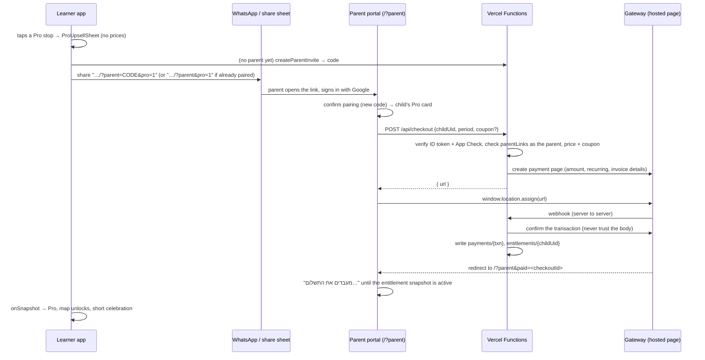

# Pro Tier & Payments (EnglishVibe Pro)

> Backlog: "Define the Freemium vs. 'EnglishVibe Pro' tier boundaries … design the kid-safe 'Ask a Parent on WhatsApp' payment link flow … plan integration with an Israeli payment gateway … and server-verified Firestore subscription status. Also create a coupon system."

Status: **design only**. Nothing here is built yet. The phases in "Implementation phases" are the build order.

## Goal
Most of the app stays free. A paid **EnglishVibe Pro** subscription (monthly or yearly) unlocks the full curriculum and the Pro content packs, full exam prep, more word lists and every theme and mascot. The learner never pays and never sees a checkout. They ask a parent, and the paired parent pays from the parent portal. Only the server decides who has Pro.

## Principles
- **Kid-safe.** The learner app shows no prices, no card form and no payment page. It shows what Pro unlocks and one button that asks a parent.
- **The payer is the paired parent.** Payment builds on parent pairing (§4.21): the parent's own Google account, `parentLinks/{parent}_{child}`. Links carry a parent code, never a learner uid.
- **The server owns entitlements.** `entitlements/{childUid}` is written only by Vercel Functions with the service account. Clients can read it but never write it.
- **Nothing is taken away mid-progress.** A mission that already has stars stays playable without Pro, and so do exam plans and word lists that already exist. Gating only stops *new* paid content.
- **Gating sits outside the current lock logic.** The progress locks (`isMissionUnlocked`, the Boss star gate, `isMockUnlocked`) keep working as they do. A separate Pro layer is added on top of them.
- **Hebrew copy** that speaks to the learner is gendered (`getHebrewCopy`). Copy that speaks to the parent is gender-neutral plural ("אפשר לשדרג…").

## Decisions
| Question | Decision |
| :--- | :--- |
| Product | One plan, **EnglishVibe Pro**, billed monthly or yearly (the yearly price is cheaper per month). |
| Exam Booster Pass (one-time) | Not now. Exam prep is a Pro feature. It is an open question for later. |
| Gateway | Gateway-agnostic `PaymentProvider` interface. Expected **Grow (Meshulam)**, possibly **SUMIT**; the choice is open. A `mock` provider is used for the emulators and e2e. |
| Where Pro lives | `entitlements/{childUid}`, **not** on `LearnerProfile`. Sync and `mergeLearnerProfiles` are not affected. |
| One subscription covers | One child. A family plan or sibling discount is open. |
| Existing users | None yet besides the developer's own children, who get a `comp` grant (`scripts/grantPro.mjs`). Starred missions stay playable for everyone. |
| Rollout switch | `PRO_GATING_ENABLED` (in `config/proTier.ts`) stays `false` until payments work end to end. Until then everyone plays everything. |
| Diamonds-bought items | Separate from Pro. The Sticker Studio Pass (`hasStickerPass`, `data/stickers.ts`) stays a 150-diamond shop item. Diamonds never buy Pro, and Pro never grants diamonds. |

## Tier boundaries
| Area | Free | Pro |
| :--- | :--- | :--- |
| Missions (core curriculum) | **Units 1–2** of every grade (all their missions and Bosses). Grade 1, which has 10 units, gets units 1–5 | Every unit and Boss of every grade |
| Content packs (§4.26), once released | Packs released as **free**: all their units | Every pack, including those released as **Pro only** |
| Themes & mascots (§4.3, §4.17) | **2 themes** (one light, one dark) and **2 mascots**; every other theme and mascot is shown and can be previewed | All 6 themes and all 6 mascots |
| Placement test (§4.8) | ✓ | ✓ |
| Exam prep (§4.9) | Setup, plus the plan's **first day** of practice as a taste | Full plans, every session, the mock exam and the "Exam Ready" certificate |
| School Word Lists (§4.11) | **2** active lists | 10 (`MAX_ACTIVE_LISTS`) |
| Friends Hub & contests (§4.14) | ✓ | ✓ |
| Room, wardrobe, games book, stickers, shop, diamonds | ✓ (shop items still cost diamonds) | ✓ |
| Streak, quests, weekly report, parent portal, reminders | ✓ | ✓ |
| Read-aloud voice, mini-lessons | ✓ for every mission the learner can play | ✓ |

Reasons:
- **Half of every grade is free** (units 1–2 of the four core units). A learner gets a real taste of their own grade, and the placement test's recommended grade is still worth trying. Units 3–4 are the Pro half. Grade 1 has 10 units: the letters (1–4), blending (5–6) and the topics (7–10). Its free half, units 1–5, keeps the whole alphabet and the first blending unit free. Each grade's free units are one config map, so this can be changed per grade.
- **Packs are free or Pro when they are released.** That is a release decision, not a property of the content, so it lives on the `RELEASED_CONTENT_PACKS` entry (see "Content packs" below).
- **Themes are a visible, low-stakes reason to upgrade.** A free learner sees all six and can try any of them, but only keeps the two free ones. The free pair is one playful light theme (Cozy Studio) and one grown-up dark theme (Urban Night), so both young children and older students have a free theme that suits them.
- **Friends and contests stay free** because they are what keeps learners coming back, and contests draw on the learner's own grade, with no paid content needed.
- **Contest questions** come from every unit. That is fine: contests are short, have no hints and are not a way around the mission path.

All limits are named constants in one file, `config/proTier.ts`:
- `FREE_CORE_UNITS_BY_GRADE`: `{ 1: [1, 2, 3, 4, 5] }`, every other grade `[1, 2]` (`DEFAULT_FREE_CORE_UNITS`)
- `FREE_THEME_IDS = ['cozy-studio', 'urban-night']`: one playful light theme and one grown-up dark one
- `FREE_COMPANION_IDS = ['mochi', 'kai']`: those two themes' own mascots (Mochi the Cat, Kai the Raccoon)
- `FREE_WORD_LISTS = 2`
- `FREE_EXAM_PREP_DAYS = 1`
- `PRO_GRACE_DAYS = 3`
- `PRO_GATING_ENABLED`

## Entitlement model
`entitlements/{childUid}` holds one document per learner:

| Field | Type | Notes |
| :--- | :--- | :--- |
| `plan` | `'pro'` | Room for a future pass. |
| `status` | `'active' \| 'past_due' \| 'canceled' \| 'expired'` | `canceled` = won't renew, still Pro until `periodEnd`. |
| `source` | `'subscription' \| 'comp' \| 'coupon'` | `comp` = free grant (family, testers). `coupon` = 100% coupon, no payment. |
| `billingPeriod` | `'monthly' \| 'yearly' \| null` | `null` for `comp`. |
| `periodEnd` | number (ms) | Pro until this time (plus `PRO_GRACE_DAYS`). A far-future value for open-ended `comp`. |
| `payerParentUid` | string \| null | The parent who pays. Shown to that parent only. |
| `provider` / `providerRef` | string | e.g. `'grow'` plus its recurring-payment id. Used to cancel. |
| `updatedAt` | number (ms) | |

- **Client.** A new `services/entitlementService.ts` reads the document with `onSnapshot`, and a new `useEntitlement(uid)` hook does the same. It caches the last value in localStorage (`english_tutor_entitlement_<uid>`) so Pro works offline and the first paint after a restart is right.
- **`isPro(ent, nowMs)`** is a pure function in `data/proGate.ts`: `status !== 'expired' && nowMs < periodEnd + PRO_GRACE_DAYS * DAY_MS`.
  - No document means free.
  - A failed read shows the cached value, or free if nothing is cached, and never errors loudly. Losing Pro for a moment offline is better than blocking play.
  - Times use server `ms` timestamps, not local calendar days. This is a billing period, not a learning day.
- **Rules** (`firestore.rules`, a new block after `pushSubscriptions`):
  - **Read:** `request.auth.uid == childUid`, or the reader is a linked parent (`exists(linkPath(request.auth.uid, childUid))`, reusing the parent block's helper).
  - **Write:** `false`. Only the service account writes, and it bypasses the rules.
  - Same for `checkouts`, `payments`, `coupons` and `couponRedemptions`: no client reads or writes, except a parent reading their own `checkouts/{id}` for the return page.
- **Smoke test** (`scripts/emulator/rulesSmoke.mjs`), a new "entitlements" section:
  - A learner can read their own document.
  - A linked parent can read it; an unlinked user cannot.
  - Nobody can write (create, update, delete).
  - `coupons` cannot be read.
- **Account deletion** (`deleteAccount`) cannot delete `entitlements` from the client, so a server step does it. The client calls the new `api/account-cleanup.ts`, or the daily cron removes entitlements whose learner no longer exists.
  - The parent is told that an active subscription keeps billing until it is canceled. Deletion cancels it through the provider, in the same server step.

## Gating layer (`data/proGate.ts`)
One pure, tested module. It takes the entitlement and returns decisions; the UI only reads them.
- `canPlayMission(unit, missionId, progress, isPro)`:
  - true if `isPro`, `!PRO_GATING_ENABLED`, the unit is a core unit whose `unitNumber` is in the grade's free core units, the unit belongs to a pack released as free, or `progress[missionId] > 0` (stars kept).
- `canUseTheme(themeId, isPro)` and `canUseCompanion(companionId, isPro)` check the theme or mascot against `FREE_THEME_IDS` / `FREE_COMPANION_IDS`.
- `resolveAllowedLook(profile, isPro)` returns the theme and mascot to draw:
  - It gives the saved choice when it is allowed.
  - Otherwise it falls back to the free theme with the same `isDark`, and to that theme's free mascot.
  - The saved `themeId` / `companionId` are never overwritten, so renewing Pro brings the learner's choice back.
- `canStartExamPlan(isPro)` and `canOpenExamSession(plan, session, isPro)`:
  - Free learners can make a plan and play day 1. Later sessions and the mock show the paywall.
  - A plan made while Pro keeps working until its exam date, even if Pro lapses.
- `maxWordLists(isPro)`:
  - `isPro ? MAX_ACTIVE_LISTS : FREE_WORD_LISTS`.
  - `canAddList` (`data/customWordLists.ts`) gains a `limit` argument. Lists already saved above the free limit stay and can be practised; only adding is blocked.

**Map.**
- `getMapStopStates` (`data/worldMap.ts`) gets a fourth status, `'pro'`. It applies only when the stop would otherwise be `'open'` or `'locked'` and `canPlayMission` is false. Progress order still matters: a Pro stop that is also progress-locked shows `'locked'` to a Pro learner.
- `MapStops` draws a coin with a small "Pro" crown badge, not the grey lock.
- `MissionSheet` shows the Pro card (below) instead of Start.
- `isMissionUnlocked` (`data/milestones.ts`) is not changed.

**Content packs.**
- `ReleasedPack` (`data/curriculum/packs/types.ts`) gains `access: 'free' | 'pro'`, set when the pack is added to `RELEASED_CONTENT_PACKS` (`registry.ts`).
- Pro-only pack units appear on every learner's map as `'pro'` stops, so free learners can see what they would get.
- For a free learner, the one-time `NewPackCard` says the pack is part of Pro and offers the ask-a-parent button instead of "start".
- The "חדש!" banner tag is unchanged.
- §4.26's release steps get one more line: choose `access`.

**Themes and mascots (settings → "עיצוב וקול").**
- Both pickers (the theme buttons in `components/settings/ProfileFields.tsx` and `components/settings/CompanionPicker.tsx`) still show **all** six themes and six mascots. The non-free ones get a small "Pro" crown badge and no grey-out: they should look as good as they are.
- **Preview.** Tapping a Pro theme or mascot as a free learner shows it at once, as a temporary preview held in memory in `App` (`previewThemeId` / `previewCompanionId` state that `resolveTheme` uses before the profile value); nothing is saved through `handleUpdateProfile`. While a preview is on:
  - A sticky banner at the bottom of settings says "תצוגה מקדימה: <theme name>" and has two buttons: "לבקש מהורה" (opens the `ProUpsellSheet`) and "חזרה לעיצוב שלי".
  - The learner can move around inside settings and try the other Pro themes and mascots.
  - The preview ends, back to the saved look, when the learner leaves settings or closes the app. It is never written to localStorage or the cloud.
- The free themes and mascots work exactly as today: one tap saves them.
- **Onboarding** (`OnboardingView`) offers only the free themes, and a learner who already has Pro sees all of them. The default stays `cozy-studio` / `mochi`.
- **A lapsed Pro learner**:
  - `resolveAllowedLook` draws the matching free look.
  - The picker marks their saved Pro choice as "שלך עם Pro".
  - Nothing is reset.

**Home.**
- The Play button never points at a Pro mission. Today's mission (`getSuggestedMission`, `data/milestones.ts`) skips Pro-locked missions. When every free mission is done, the hero shows a gentle "you finished the free missions" card that asks a parent.

## The kid-safe "ask a parent" flow


**Learner side: `components/pro/ProUpsellSheet.tsx`.**
- A bottom sheet with the theme's companion, a short gendered line ("רוצה להמשיך להרפתקה הבאה?"), and what Pro opens, as icons: all units and Pro packs, exam prep, more word lists, every theme and mascot. Opened from a theme preview, the sheet leads with the themes.
- One button: "לבקש מהורה" (WhatsApp icon).
- No prices or plans anywhere.
- **No parent paired:**
  - Reuse `createParentInvite` (`services/parentService.ts`), which gives an 8-character code that lasts 2 days.
  - Build `buildParentUrl(origin, code) + '&pro=1'` and share it through `navigator.share`, or `https://wa.me/?text=…` as a fallback, the same pattern as `ShareTextActions` (weekly report).
- **A parent is already paired** (`listParentsOfChild`):
  - Share `/?parent&pro=1`, with no code and no uid. The parent signs in, and the portal opens straight on that child's Pro card. With more than one child, it opens the child list with the Pro buttons shown.
- The message is fixed Hebrew addressed to a parent, e.g. "היי! אני לומד/ת אנגלית ב-EnglishVibe ורוצה לפתוח את כל השיעורים. אפשר לשדרג כאן: <link>", inflected by the learner's gender.
- **Rate limit.** One ask per day per learner (`localStorage`), and the sheet shows "שלחת כבר בקשה היום". This is about kindness to parents, not security; the server does not need it.
- **Guests** (anonymous) are first asked to save the account (`saveGuestWithGoogle` / `saveGuestWithUsername`), because Pro attaches to a uid a guest can lose.

**Parent side: the parent portal (`components/parent/`).**
- `ChildCard` gets a Pro line:
  - Free: "גרסה חינמית" and a "שדרוג ל-Pro" button.
  - Pro: "Pro פעיל עד 12.11.2026 · מתחדש חודשי".
  - Canceled: "בוטל, פעיל עד …".
  - Comp: "Pro (מתנה)".
- **`ProCheckoutPanel`** (new):
  - Monthly vs. yearly with prices (VAT included) and an optional coupon field ("קוד הנחה"). The price shown after a coupon comes from the server (`api/checkout` with `dryRun: true`).
  - The recurring-charge notice and the cancellation terms appear next to the button, as consumer-protection law requires.
  - "המשך לתשלום" goes to the hosted page.
- **Return page** `/?parent&paid=<checkoutId>`:
  - Watches the child's entitlement for up to ~60 s. Then it shows "התשלום התקבל, ההפעלה עשויה להימשך עוד דקה" with a refresh button.
  - A failed or canceled payment returns to `/?parent&paid=<id>&status=fail` and shows a calm retry.
- **"ביטול המנוי"** sits on the Pro card behind a confirm step (as easy to find as the upgrade). It calls `api/subscription.ts`. Pro stays on until `periodEnd`.
- `parseParentParam` / `isParentRoute` (`data/parentLink.ts`) already accept extra params. New helpers `readProIntent(search)` and `readPaidCheckout(search)` sit next to them.

## Server
All functions follow `api/parent-reset-pin.ts`:
- POST only.
- The parent's Google ID token (`verifyFirebaseIdToken` + `readFirebaseClaims`, `signInProvider === 'google.com'`).
- App Check when `APPCHECK_ENFORCE === 'on'`.
- The pairing checked by reading `parentLinks/{parent}_{child}` **as the parent**.
- Writes with `createFirestoreAdmin` (`api/_lib/firestoreAdmin.ts`).
- Injectable deps for unit tests; only an error status is logged (no tokens, no card data).

| Function | Does |
| :--- | :--- |
| `api/checkout.ts` | Validates `{childUid, period, couponCode?, dryRun?}`, computes the price on the server from `config/proTier.ts` prices and the coupon (the client price is never trusted), and writes `checkouts/{id}` (`childUid`, `parentUid`, `period`, `amountAgorot`, `couponCode`, `status: 'pending'`, `createdAt`). It calls `provider.createPaymentPage(...)` with the success, fail and webhook URLs and returns `{ url }`. A 100% / `comp` coupon writes the entitlement directly and returns `{ activated: true }`. |
| `api/payment-webhook.ts` | Gets the gateway's notification and calls `provider.verifyNotification(req)`, which **re-queries the gateway API** for the transaction, its amount and status. It is idempotent on `payments/{provider}_{txnId}` (create-if-absent). On success it sets `entitlements/{childUid}` (`active`, `periodEnd` = the later of now or the current `periodEnd`, plus the period) and marks the checkout `paid`. Recurring charges, failures and cancellations from the gateway update `status`. It answers 200 quickly, as gateways retry on errors. |
| `api/subscription.ts` | `cancel`: checks the parent owns the subscription (`payerParentUid`), calls `provider.cancel(providerRef)` and sets `status: 'canceled'`. |
| `api/streak-reminder.ts` (the daily cron) | One more step: `reconcileEntitlements` sets `expired` where `periodEnd + grace` has passed, and asks the provider about `past_due` subscriptions to catch a missed webhook. It stays one cron (Hobby plan). |

**Provider interface** (`api/_lib/payments/provider.ts`):
```ts
interface PaymentProvider {
  createPaymentPage(input: { checkoutId: string; amountAgorot: number; period: 'monthly' | 'yearly';
    payerEmail: string; payerName: string; description: string; successUrl: string; failUrl: string;
    notifyUrl: string }): Promise<{ url: string; providerRef: string }>;
  verifyNotification(req: Request): Promise<VerifiedPayment | null>;   // re-queries the gateway
  cancel(providerRef: string): Promise<void>;
}
```
- `api/_lib/payments/grow.ts`: Grow (Meshulam) "create payment process" with a recurring-payment setting; the notify callback is followed by a transaction lookup / approve call.
- `api/_lib/payments/sumit.ts`: SUMIT recurring billing with a redirect page; the notification is followed by a payment lookup.
- `api/_lib/payments/mock.ts`: for the emulators and e2e. `createPaymentPage` returns `/?parent&mockpay=<id>`, a tiny "pay / fail" page in dev builds only, which posts a signed fake notification.
- The adapter is chosen by `PAYMENT_PROVIDER`. `mock` is refused when `VERCEL_ENV === 'production'`.
- Exact endpoint names and fields come from the chosen gateway's docs at build time (phase 3). The interface is the contract.

**Env** (Vercel Production + Preview, and `.env.local`):
- `PAYMENT_PROVIDER`
- `GROW_API_KEY`, `GROW_PAGE_CODE`, `GROW_USER_ID` (or `SUMIT_COMPANY_ID`, `SUMIT_API_KEY`)
- `PAYMENT_WEBHOOK_SECRET`, a path token on the notify URL, as a first filter before the API re-check
- The existing `FIREBASE_SERVICE_ACCOUNT_JSON`

**`vercel.json`.**
- Add `maxDuration` for the new functions.
- The redirect is a top-level navigation (`window.location.assign`), so `connect-src`, `form-action 'self'` and `Permissions-Policy: payment=()` stay as they are. The hosted page is never embedded in an iframe, so `frame-src` does not change.

## Payment methods and invoices
- Bit, Apple Pay, Google Pay and cards are all handled on the gateway's hosted page. Apple Pay needs the gateway's domain verification for the production domain (depends on the "Domain and Email" backlog item).
- **Invoices.** Both Grow and SUMIT can issue the tax invoice/receipt (חשבונית מס / קבלה) automatically for every charge, including recurring ones, and email it to the parent. Morning (Green Invoice) is needed only if the chosen gateway's invoicing doesn't fit. The invoice name and email are the parent's, from Google, and can be edited on the hosted page.
- Prices are stored in agorot and shown VAT-inclusive.

## Coupons
| Collection | Fields |
| :--- | :--- |
| `coupons/{CODE}` | `type: 'percent' \| 'fixed' \| 'free_months' \| 'comp'`, `value`, `periods` (which billing periods), `firstChargeOnly` (bool), `validFrom`, `validUntil`, `maxRedemptions`, `redeemedCount`, `oncePerParent`, `note` |
| `couponRedemptions/{CODE}_{parentUid}` | `childUid`, `checkoutId`, `at` |

- Codes are case-insensitive A–Z/2–9 and are checked only in `api/checkout.ts`. A wrong or expired code returns one neutral message, "הקוד לא תקף", so codes can't be probed for details. Checkout attempts are rate-limited per parent.
- `percent` / `fixed` lower the first charge (or every charge when `firstChargeOnly` is false, if the gateway supports a changed recurring amount; otherwise first charge only).
- `free_months` pushes the first charge back: the entitlement starts now, and the recurring payment's start date is set later.
- `comp` / 100% creates an entitlement with no payment (`source: 'coupon'`).
- `redeemedCount` is incremented in the same commit that writes the redemption, so `maxRedemptions` holds under races.
- Coupons are made by an admin script, `scripts/coupons.mjs create|list|disable`, which uses the service account like `scripts/resetLearnerPin.mjs`. No admin UI.
- **Comp grants:** `scripts/grantPro.mjs <username> [--until YYYY-MM-DD]` looks the uid up through `usernames/{slug}` and writes `source: 'comp'`. This is how the developer's own children get Pro.

## Privacy and legal (checklist before going live)
- **Privacy notice** (`PrivacyNoticeDialog`): a payments paragraph.
  - The parent pays through <gateway>, and card and Bit details never reach the app.
  - The app stores the subscription status, period, payer parent account and payment record ids.
  - Invoices are kept as tax law requires.
- **Data export** (`downloadProfileJson`) includes the entitlement. Account deletion removes it. Payment records keep the amounts and dates with only the uid, no name, as tax records require.
- **Consumer protection** (Israel):
  - Clear price and renewal terms before payment.
  - Cancellation as simple as signing up (online, from the same screen).
  - Notice before a yearly renewal (an email from the gateway, or a push to the parent; to decide).
  - The cancellation rights for distance sales. Get a short legal review before launch.
- **Business:** registration (עוסק פטור / מורשה) decides VAT on invoices, and must be settled with the gateway account.
- The contact email in the privacy notice and on invoices should use the new domain ("Domain and Email update" item).

## Implementation phases
Each phase ships on its own. `PRO_GATING_ENABLED` stays `false` until phase 5.

1. **P1: entitlements and gating, no payments.**
   - New files:
     - `config/proTier.ts`
     - `data/proGate.ts` (+ tests)
     - `services/entitlementService.ts`
     - `hooks/useEntitlement.ts`
     - `components/pro/ProUpsellSheet.tsx` (+ component test)
     - `scripts/grantPro.mjs`
   - Changes:
     - The `'pro'` map status in `worldMap.ts` / `MapStops` / `MissionSheet`.
     - The `canAddList` limit.
     - Exam-prep session checks.
     - `ReleasedPack.access` and Pro pack stops.
     - Theme and mascot gating: the Pro badges in `ProfileFields` / `CompanionPicker`, the in-memory preview and its banner, `resolveAllowedLook` in `App` (+ component test for the preview never saving).
     - The rules block and the smoke-test section.
   - Tests run with the flag on, and the app ships with it off.
2. **P2: checkout on the mock provider.**
   - `api/checkout.ts`, `api/payment-webhook.ts`, `api/subscription.ts`, `api/_lib/payments/{provider,mock}.ts` (unit tests with injected deps).
   - The parent portal's Pro card, checkout panel and return page.
   - A Playwright e2e: learner asks → parent pays (mock) → learner's map unlocks.
3. **P3: the real gateway.**
   - The Grow (or SUMIT) adapter in sandbox, the recurring charge, the invoice, cancel, and the cron reconcile.
   - Then the live keys, with one real low-price charge and its refund done by hand.
4. **P4: coupons.** `coupons` / `couponRedemptions`, the checks in `api/checkout.ts`, `scripts/coupons.mjs`, the coupon field in the panel.
5. **P5: launch.**
   - The privacy notice and legal checklist.
   - Turn on `PRO_GATING_ENABLED`.
   - `comp` grants for family accounts.
   - Check on desktop and phone.

## Open questions
- Prices: monthly ₪? yearly ₪? (Suggested shape: yearly ≈ 8 × monthly.)
- Free word lists: 2? Exam prep free taste: day 1 only, or one full skill?
- Grade 1's free units: 1–5 (all letters plus the first blending unit), or 1–4 (the letters only)?
- Family plan or sibling discount (several children under one parent)?
- A free trial (e.g. 7 days of Pro on the parent's first upgrade), or coupons only?
- Final gateway: Grow vs. SUMIT. Compare fees, Bit support **for recurring** charges, invoice API, sandbox quality and payout terms.
- Bring back a one-time "Exam Booster Pass" (e.g. 30 days of exam prep) later?
- Yearly-renewal reminder: from the gateway's email, or our own push to the parent?
